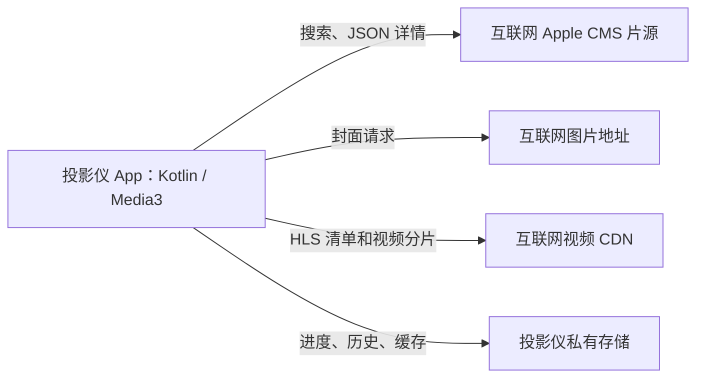

# LibreTV 独立版 TV：Kotlin 直连 P0 验收报告

历史记录：此文对应 0.1.0-p0；推荐首页已在 0.1.1-p0 补齐，最新记录见 recommendation-home-acceptance.md。

日期：2026-10-28。设备：坚果 N5 Pro / K981CN，Android 14 / API 34，ARM64。

## 结论

已验证可将 LibreTV 的 Apple CMS 搜索、JSON 详情和播放列表解析移到 DpadTV 的 Kotlin 客户端。普通源的目录与视频均可由投影仪直接取得，本阶段无需内嵌 Node.js 或 Next.js。独立 APK 已安装，与原版 DpadTV 并存。

这是 P0 可行性验证成果，还不是完整 LibreTV。真实关闭 Windows、投影仪重启、长时间播放、网络中断恢复以及完整更新机制尚未完成验收。

## 本次交付

- `LibreTV-Standalone-TV-0.1.0-p0.apk`：已安装的独立验证包。
- `LibreTV-Standalone-TV-source.zip`：完整对应源码、构建说明、固定版解析参考代码和许可证。
- `LibreTV-Standalone-P0-device-probe.json`：N5 上运行生产 Kotlin API 的逐源结果。
- `LibreTV-Standalone-P0-JVM-tests.json`：本地测试计数。
- `LibreTV-Standalone-P0-evidence.json`：安装身份、签名、保留状态和验收边界。
- `SHA256SUMS-LibreTV-P0.txt`：交付文件摘要。

源码来自独立的 Android TV 适配仓库；设备测试未修改原 Windows LibreTV 工程。

## 数据路径

原版 DpadTV：搜索、详情、封面由投影仪经 ADB reverse 访问 Windows 的 LibreTV；已实测的普通视频由投影仪直接连接视频源。原版的请求失败曾由转发丢失引起，已恢复。

本次独立包：

新包不请求 Windows 的 `127.0.0.1:18080`，没有内嵌服务端，不启动 HTTP 监听器，也没有开放代理或内部 API 密码管理。原版的 `18080 → 8080` 转发继续保留。

## 核心证据

本地 36/36 JVM 测试通过：22 个样例由随附 LibreTV v2.21.1 的真实 TypeScript 函数生成，另有 3 个解析边界和 11 个网络客户端测试。覆盖关键词编码、已有查询参数、详情直链、最多 5 页、单源失败保留其它结果、部分页失败、图片 HTTP 错误、相对重定向、跳转循环上限和响应头等待超时。

N5 的生产 API 探针搜索“三体”得到 57 条相关来源结果，耗时 12409 ms。9 个片源中有 7 个搜索成功；分别选取其中一个结果请求详情，7/7 返回集数，7/7 媒体列表样本 HTTP 200。

| 片源 | 搜索快照 | 选定详情集数 | 媒体列表样本 |
| --- | --- | --- | --- |
| 360 | 成功 | 53 | 200 |
| 量子 | 成功 | 15 | 200 |
| 极速 | 成功 | 15 | 200 |
| 豪华 | 成功 | 40 | 200 |
| 金鹰 | 成功 | 15 | 200 |
| 非凡 | 成功 | 15 | 200 |
| 暴风 | 成功 | 15 | 200 |
| 光速 | 汇总等待超时 | 未测试 | 未测试 |
| 如意 | SocketException | 未测试 | 未测试 |

媒体列表最多采样 2048 字节，HTTP 200 不代表整部视频都能播放，也不是对全部结果的可用性承诺。上述 JSON 探针在最终批量测试修复前运行；之后没有修改搜索、详情或媒体解析实现。

原生界面另以“007”实测：显示 112 个片名分组 / 185 条来源结果，方向键和 OK 进入详情、选择集数，Media3 实际解码播放《007：大破量子危机》。观察进度 `0:30 → 1:00`；右键快进后 `1:10 / 104:46`。暂停、继续、返回和观看历史入口通过 ADB 注入标准遥控键验证；没有要求鼠标操作。

播放中进程 UID 10099 直接连接外网；一次外网连接的 `bytes_received` 为 10863368 字节。未观察到该 UID 的本地 TCP 监听端口，套接字记录不含对本地 18080 目录服务的连接。视频缓存增长到 18587 KB。此证据支持普通路径不经 Windows 服务；它不代替真正关闭 Windows 的验收。

首次 Activity 冷启动为 1359 ms，后续冷启动为 1071/1080 ms，仅为少量界面启动样本。详情页 PSS 92766 KB；播放页 PSS 111053 KB、RSS 257008 KB，均为单次快照，不是峰值或长时间内存结论。

## 已处理的问题与保留边界

两个普通源最初返回 HTTP 301。Android 的现有连接没有自动跟随观察到的 HTTP→HTTPS 跳转，补上有上限的直接跳转处理后，360 和极速的搜索、详情、媒体列表均通过。没有放宽 TLS 校验。

独立审阅发现批量片源测试把异常丢为 null，可能误报“全部可用”。已修正为保存失败并计数，也把错误显示的“返回条数 ms”改为实际耗时。最终包在 N5 上运行全部测试，9 条状态全部落盘，7 条为 true、2 条为 false，界面实际标出失败。这与关键词搜索是不同请求；可用源名单会随网络和时间波动。

本地连接与读取设置超时，搜索汇总约 12 秒后返回。连接、TLS 和持续读取响应体的组合尚不是严格的整次请求总时限；批量探测中观察到一次 30399 ms。当前没有把总时限压力场景宣称为通过。

电脑与投影仪的网络路径不同，同一来源的请求结果可能不同。应以设备端的错误与响应为准，不能仅凭电脑端返回 200 判断投影仪必须使用代理。

部分外部封面未能加载，当前采用占位图；不影响目录和播放。P0 没有专门迁移图片代理或逐图诊断。

## 并存与数据保留

| 项目 | 原版 | 本次独立包 |
| --- | --- | --- |
| 包名 | com.dpadtv.client | local.libretv.standalone.tv |
| 名称/版本 | DpadTV 1.2.0 / 102 | LibreTV 独立版 P0，0.1.0-p0 / 1 |
| UID | 10104 | 10099 |
| 目录服务 | Windows LibreTV | 无 |

最终包以 `install -r` 覆盖首个 P0 包，片源、搜索历史及进度 70495 ms 保留；观看历史仅生命周期更新时间变化。覆盖后“继续观看”实际显示 `1:10 / 104:46`。最终安装包随后从历史记录继续播放，观察到进度增长到 `2:56 / 104:46`。这是同版本覆盖安装的数据验证，尚不能代替未来版本升级流程验收。

原版偏好文件安装前后 SHA-256 均为：

`968b27757ec658acd2f49a0daaf4ce8cd9fb1316a194f086d0b709e3276c2a31`

独立包证书 SHA-256：

`3edd8eca1250b5cbb67794c9544e2da5ad6e67490e03ab015454b0be5a15d1e6`

APK 签名校验通过，v1/v2 为 true。该包用于 P0 调试验证。签名文件留在工程 `.signing`，未进入 Git 或源码压缩包；继续覆盖升级必须保留该目录。接收源码的人可生成自己的签名，但不能用新密钥覆盖此处交付的安装包。

## 功能覆盖与后续顺序

| 功能 | 本次范围 |
| --- | --- |
| Apple CMS 搜索、JSON 详情、季度别名、线路提取 | 已移植并验证；相关性只覆盖给定对照样例 |
| 封面墙、按源筛选、手动同名换源 | 复用 DpadTV；逐项实机覆盖尚未全部完成 |
| 原生播放、方向键导航、暂停、快进、缓存、历史 | 已进行上述短程实机验证 |
| 片源文本、URL、文件及 LibreTV 设置导入 | 复用原代码；未逐格式验收 |
| 自动换源、订阅自动刷新 | 未实现 |
| HTML 详情与必须代理的特殊片源 | 未实现；先保留明确失败证据，再按实际需求迁移 |
| 豆瓣推荐、热门榜单、直播列表解析 | 尚未迁移 |
| 手机扫码上传 | P0 停用，避免启动不必要的局域网监听器 |
| 应用内更新、下载校验、安装器、跨版本升级 | 尚未实现；当前只准备好独立稳定签名 |
| 真正关闭 Windows、投影仪重启、断网恢复、连续长播 | 待验收 |

下一阶段先补齐独立运行验收和实际使用中缺少的必要功能，再处理有证据表明需要代理的特殊源。现有两个网络失败不构成内嵌整个 Next.js 服务的理由。

## 简短使用与关电脑验收方法

在投影仪打开 `LibreTV 独立版 P0`，搜索片名，进入详情选集；方向键移动，OK 确认，播放时 OK 暂停或继续，左右快退或快进，返回退出。无需导入无线调试设置即可使用本 App；无线调试只在电脑连接设备时需要。

关电脑验收应实际关闭 Windows，并重新打开投影仪上的本 App，发起一次新搜索和不同视频的播放，确认进度继续增长。投影仪重启后再重复，记录结果。互联网需保持可用。本次执行过程中电脑仍用于 ADB 取证，因此这些步骤没有被标记为通过。

## 来源与构建

DpadTV v1.2.0：`4dd04cc4e394c808980aeebb2495a5af8d134e74`。LibreTV v2.21.1：`29cbeb3d37b4876f909a0354087a3531af0447f6`。前者 GPL-3.0 文本保留，后者参考源码与 AGPL-3.0 文本一并交付，修改说明见源码内 NOTICE.md。

实际构建使用 Java 21、Gradle 9.8.2、AGP 9.3.0、Android SDK 37；主 APK 和测试 APK 构建成功。完整命令与签名初始化见源码 README.md。没有修改系统、Root、刷机、引入后台系统服务或未知二进制运行时。
